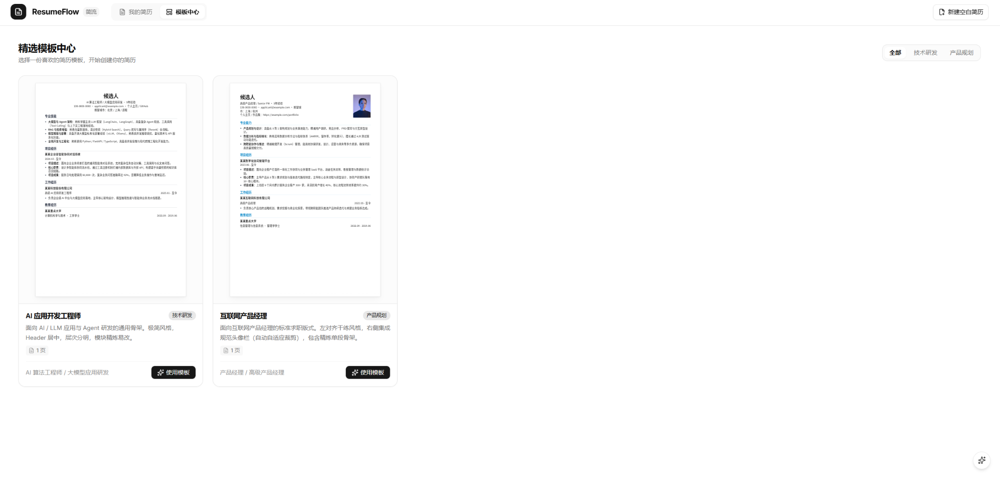

# ResumeFlow

ResumeFlow 是一款 Markdown 优先的简历工具，支持简历编辑、排版、多语言管理、样式定制和 PDF 导出。通过 MCP 或 HTTP API，AI Agent 也可以管理简历。



## Docker 启动

```sh
docker run -d --name resumeflow \
  -p 127.0.0.1:8080:3000 \
  -v resumeflow-data:/data \
  boses/resumeflow:latest
```

启动后访问 <http://127.0.0.1:8080>。数据保存在 `resumeflow-data` 数据卷中，宿主机端口可按需修改。

## 接入 AI

### Skills

安装 Agent Skills，为 AI 提供简历排版和操作指引：

```sh
npx skills add bosens-China/ResumeFlow
```

安装后，将服务地址提供给 AI Agent。例如：

```text
使用 ResumeFlow 管理我的简历，服务地址为 http://127.0.0.1:8080。
未连接 MCP 时，请先读取 http://127.0.0.1:8080/api/openapi.json，再按文档调用 HTTP API。
```

### MCP（可选）

MCP 不是必需的。安装 Skills 并提供服务地址后，具备 HTTP 请求能力的 AI Agent 即可通过 HTTP API 管理简历。

将 `http://127.0.0.1:8080/mcp` 添加到支持 MCP 的客户端，即可通过 MCP 工具管理简历。

请将以上示例地址替换为 AI Agent 能够访问的实际服务地址。

## 开源协议

本项目采用 [MIT 许可证](LICENSE)。
